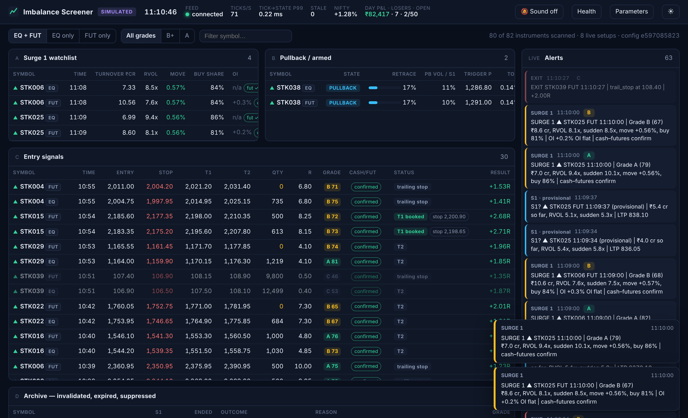

# Imbalance Setup Screener

A real-time screener for the **imbalance setup** in NSE F&O stocks and their stock futures:
an institution-sized Surge 1, a quiet pullback, then a Surge 2 that is the entry signal.
It ingests live broker snapshots, builds 1-minute candles on exchange time, runs every
instrument through the state machine of the specification, and raises alerts with a full
trade plan (entry, stop, targets, size) on a live dashboard and Telegram.

**Version 1 is alerts only and places no orders.** Every default threshold is a starting
value to tune by backtesting, not a proven setting. This is a screening tool, not
investment advice; all trading decisions remain yours.



*The dashboard running `imbalance demo`: fictional symbols and a synthetic market with
injected patterns. The results shown say nothing about whether the setup works.*

- Specification (source of truth): [docs/SPEC.md](docs/SPEC.md)
- Design notes — the state machine restated, every ambiguity and the choice made, open questions: [docs/DESIGN.md](docs/DESIGN.md)

## Quick start: the demo (no broker needed)

The demo runs a synthetic market of fictional stocks through the real engine and dashboard,
with imbalance patterns injected so every path of the state machine shows up.

```bash
python3.12 -m venv .venv && . .venv/bin/activate
pip install -e ".[dev]"
```

```bash
cd dashboard && npm ci && npm run build && cd ..
```

```bash
imbalance demo --speed 10 --start 10:00
```

Open http://localhost:8000. Click any row for the chart, rule checklist, grade breakdown and
event log; turn on sound in the header for the alert tones. In the demo the daily guardrails
are relaxed so entries keep flowing (`--keep-guardrails` keeps them).

## Going live with Zerodha Kite Connect

1. Create a Kite Connect app and set its redirect URL to `http://<your-host>:8000/kite/callback`.
2. `cp .env.example .env` and fill in `KITE_API_KEY`, `KITE_API_SECRET` (and Telegram, below).
3. Start the screener (it waits for the 08:30 IST start-up routine, then runs each trading day):

   ```bash
   imbalance live --daemon
   ```

4. Each morning, log in at `http://<your-host>:8000/kite/login` (Kite access tokens expire
   daily; the screener shows a banner and sends a Telegram reminder). From a terminal,
   `imbalance login` prints the login URL and `imbalance login --request-token <url>` saves
   the session.

The start-up routine downloads the instrument master, builds the day's universe (cash share
and current-month future of every F&O stock, next-month future in rollover week, NIFTY and
BANKNIFTY futures for the market regime), fetches the F&O ban list, builds 20-session
same-minute baselines (from recorded candles when available, else Kite's historical API),
loads price bands from the quote API and applies the ₹25 cr liquidity floor. It then
subscribes in full mode and records every snapshot.

**Telegram:** create a bot with @BotFather, put `TELEGRAM_BOT_TOKEN` and `TELEGRAM_CHAT_ID`
in `.env`, and set `alerts.telegram.enabled: true`. Which alert types are sent and the
minimum grade are configurable.

### Docker Compose

```bash
cp .env.example .env
docker compose up -d --build
```

This runs the screener with TimescaleDB for candles and Redis for pub/sub
(`config/compose.yaml`). `docker compose --profile demo up --build demo` serves the demo on
port 8001.

## Configuration

Everything lives in [config/default.yaml](config/default.yaml): all §10 parameters, session
timings (the 2025–26 changes are config, not code), broker, storage, alerts and grading
weights. Changes are picked up without a restart.

- **Presets:** named partial overrides under `presets`, selected with `active_preset`.
- **Per-symbol overrides:** `symbol_overrides: {RELIANCE: {...}, "TATASTEEL:FUT": {...}}`.
- **Dashboard edits** go to `config/local.yaml` (merged on top, validated before writing).
  Set `IMBALANCE_API_TOKEN` to require a bearer token for edits, mutes and pauses.
- `imbalance check-config` validates a file.

Reference data: `data/reference/events.csv` (results, ex-dates, index events, halts) and
`holidays.csv`; see [data/reference/README.md](data/reference/README.md).

## Backtesting, replay and the paper-trading gate

The backtest calls the same engine as live mode.

```bash
imbalance universe --out universe.json
```

```bash
imbalance history --universe universe.json --days 365
```

```bash
imbalance backtest --history data/history --from 2025-11-01 --to 2026-10-31 --out reports/
```

`reports/report.md` has the funnel (Surge 1 → armed → Surge 2 → winners), win rate, average
R, expectancy, profit factor, drawdown and MAE/MFE — overall and split by grade, time of
day, EQ vs FUT, OI reading, event day and market regime — and **the core test**: entering at
Surge 2 against entering at Surge 1 and against random entries at the same times of day.
If Surge 2 doesn't beat both after costs, the imbalance story isn't adding value.

- `--walk-forward` tunes `backtest.walk_forward.grid` (fit 6 months, test 2, roll) and
  reports parameter sensitivity.
- Candle-only backtests use candle shape for direction (no buy/sell split or intra-minute
  OI in broker history); fills at candle prices plus the configured slippage, costs from
  the configured table (placeholder rates — confirm them against your contract notes).
- `--mode ticks` replays recorded days through the full pipeline (buy/sell split, OI).
- `imbalance replay --date 2026-11-18 [--serve --speed 20]` replays a recorded day, fast or
  through the dashboard. The live clock is recorded too, so a replay reproduces the live
  event log exactly.
- `imbalance backtest --synthetic-days 30` checks the pipeline on synthetic data (it says
  nothing about the trading idea).
- `imbalance paper-report` summarises live alerts with simulated fills against the gate:
  at least 4 weeks and 50 entry signals with positive expectancy after costs, then compare
  with the backtest range before using real money.

## How it works

```
Kite websocket ─┐                     ┌─ event log (JSONL: every transition and its inputs)
Simulated feed ─┼─► Processor ────────┼─ alert dispatcher ─► dashboard (WebSocket) / Telegram
Recorded ticks ─┘   candle builder    ├─ raw recorder (Parquet: snapshots, feed and clock events)
                    setup engine      └─ candle store (SQLite or PostgreSQL/TimescaleDB)
```

- **Turnover** is the change in cumulative ATP × volume across each candle's boundaries, so
  missed snapshots never lose turnover; implausible values fall back to ΔV × mid and are flagged.
- **Candles** close for all instruments together at the minute boundary + 1.5 s, which keeps
  replays deterministic and lets the same-minute cash–futures check see both legs.
- **Provisional** alerts fire mid-candle on running turnover; **confirmed** alerts at the close,
  or a cancellation with the failed rules.
- Feed gaps and 30-second silences flag candles as gap-affected (they cannot trigger) and
  invalidate live setups; the pre-open auction and the cash closing auction are excluded.
- The optional short setup runs the same code on a mirrored price view.

Measured here (4-vCPU container): sustained **1,000 snapshots/s over 422 instruments**, tick-to-state
latency **p50 1.1 ms, p99 7 ms** (target < 50 ms), with all instruments' candles closed every
minute; raw processing ≈150,000 snapshots/s; confirmed alerts are produced at the candle
close (boundary + grace) in a few milliseconds.

## Tests

```bash
pytest -q
```

Every acceptance scenario of §13 is an automated test (mapping in
[docs/DESIGN.md §5](docs/DESIGN.md#5-acceptance-scenarios--tests)), plus unit tests for the
Kite binary parser and reconnect logic, candle builder, baselines, universe, trade
management, storage, API and backtests. The PostgreSQL store test runs when
`IMBALANCE_TEST_PG_DSN` is set.

## Compliance and limitations

- No orders are sent. Adding automatic orders brings in SEBI's retail algo framework
  (static IP, exchange Algo ID, daily 2FA, kill switch, audit trail) — confirm current rules
  with your broker first.
- Broker market data is licensed for the account holder's own use; offering this screener to
  others can require an exchange data-redistribution licence.
- Snapshot feeds (about one update per second) do not show every trade, so the buy/sell split
  is an estimate. A volume spike is not proof of an institution: news, block deals, index
  flows, option hedging, short covering and operator activity leave similar footprints.
- Feed specifics to verify on your account: futures volume units
  (`broker.kite.futures_volume_unit`), whether block-window trades appear in day volume, and
  the OI update frequency.

## Project layout

```
config/            default.yaml (all parameters), compose.yaml
src/imbalance/     engine, candle builder, baselines, adapters, storage, alerts, api, backtest, cli
dashboard/         React + Vite dashboard
tests/             acceptance scenarios 1–15 and unit tests
docs/              SPEC.md, DESIGN.md
```
