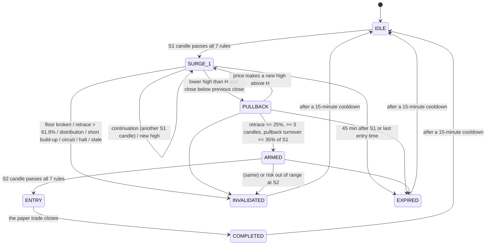

# Design notes

The source of truth is [SPEC.md](SPEC.md) (the build prompt and specification). This
document restates the state machine, lists every place where the spec was silent
or ambiguous with the choice made (the kickoff prompt says "choose the simplest
option and note it"), describes the project structure, and maps each acceptance
scenario to its test.

## 1. The state machine in my own words

One instrument (a cash share or a stock future) carries at most one live setup.



**IDLE.** On every snapshot the forming candle's *running* turnover is checked; if it
crosses the floor (₹4 cr), RVOL (5×) and suddenness (4×) thresholds while price is
above the candle's open, a **provisional** Surge 1 alert fires immediately. When the
candle closes, all seven Surge 1 rules are evaluated (turnover floor, RVOL against the
same-minute baseline, suddenness against today's previous candles, green with the
close in the top 30% of the range, ≥ 0.3% move, ≥ 60% estimated buy share, and the
session/price-band/data-quality rule). Passing confirms **SURGE_1**; a provisional
alert whose candle fails is **cancelled** with the failed rules as the reason.

**SURGE_1.** The setup records S1's OHLC and turnover, the leg start (lowest low of the
five candles before S1), and the swing high H. While price keeps rising, H follows it.
Another candle that passes every Surge 1 rule before the pullback starts is a
continuation: H and the S1 turnover take the larger value. A candle with a lower high
than H that closes below the previous close starts the **PULLBACK**.

**PULLBACK.** Tracks the retracement r = (H − lowest low since H) / (H − leg start), the
pullback turnover ratio (mean pullback-candle turnover / S1 turnover), the trigger P
(highest high of the last three completed candles, which falls as the pullback makes
lower highs) and the pullback low L. When r ≥ 25%, the pullback has lasted ≥ 3 candles,
and volume has dried up (ratio ≤ 35%), the setup is **ARMED**.

**ARMED.** Waiting for the buyer to return. A provisional Surge 2 alert fires mid-candle
when running turnover meets the S2 volume rules and LTP is above P. On the candle close,
the seven Surge 2 rules (≥ 60% of S1 turnover, ≥ ₹3 cr, RVOL ≥ 3, green/top 30%, close
above P, buy share ≥ 60%, before 15:05) decide **ENTRY**. The entry alert carries the
full plan: entry (S2 close, or a buy-stop one tick above the S2 high), stop (pullback low
minus 0.25 ATR), R, size (0.5% of capital at risk, whole lots for futures, capped), T1 =
1.5R and T2 = 3R. An S2 that closes more than 0.5 ATR above H is tagged *extended*.

**After ENTRY.** A paper trade is managed with the §7 rules: half booked at T1 and the stop
moved to entry, then trailed below the last completed 3-minute low or VWAP (whichever is
higher), the rest out at T2; a time stop after 10 candles without a new high; an
immediate exit on a sell-side surge; end-of-day exits at 15:10 (cash) / 15:25 (futures).
Daily guardrails (3 losers or −1.5% of capital; max 3 open positions) stop new entry
alerts but keep logging them.

**Invalidation and expiry** apply in every live state: a close below the floor, r above
61.8%, a distribution candle (red, ≥ 60% of S1 turnover, ≥ 60% sell share), fresh shorts
in futures (price falling, OI up, heavy turnover), a circuit/price-band hit, a halt, or 30
seconds without data. A setup expires 45 minutes after S1 or at the last entry time.
After any end state the instrument rests 15 minutes.

**Short side (§5.7, off by default).** The same machine runs on a mirrored view of the
candles: prices negated, buy and sell volume swapped. "High" in that view is the real
low, so every rule above reads correctly for shorts without a second code path.

## 2. Ambiguities and the choices made

| # | Where | Question | Choice (and where to change it) |
|---|---|---|---|
| 1 | §5.1 rule 5 | "Price change from previous close" — yesterday's close or the previous candle's? | The previous **1-minute candle's** close: the rule describes the surge candle's own jump. |
| 2 | §4 | Are window ends inclusive ("15:00 is the last new Surge 1")? | Half-open windows by candle **start**: S1 candles 09:20 ≤ start < 15:00 (last is 14:59, confirmed at 15:00); S2 candles start < 15:05. `no_signal_before`, `last_surge1_time`, `last_entry_time`. |
| 3 | §3 | When does a candle "close" for all instruments? | All instruments close together at boundary + 1.5 s grace (a batch). Deterministic, and same-minute cash–futures checks see both candles. Snapshots of the next minute inside the grace window start the next candle. |
| 4 | §3 | Snapshots arriving after the grace period for a closed minute | Attributed to the open candle (cumulative fields keep totals right) and the candle is flagged `LATE`; per-instrument data always stays in arrival order. |
| 5 | §4 | Excluding the opening auction from the first candle | The first snapshot of the day only sets the cumulative baseline (candle flagged `PARTIAL`, cannot trigger). Pre-open snapshots therefore exclude the auction trade; a mid-day restart does not dump the day's turnover into one candle. |
| 6 | §3 | "Implausible" turnover | Negative, or implied average price outside the candle's price range ±1% after allowing for paise-rounding of ATP → fallback Σ ΔV × mid, flagged `FALLBACK`. |
| 7 | §3 | "Median … smoothed over m±2" | **Pooled** median of minutes m−2…m+2 over the last 20 sessions (more spike-resistant than averaging medians). Minutes with no trade count as zero. `baseline_smoothing_minutes`. |
| 8 | §3 | Historical candles have no ATP | Baseline turnover from broker history = volume × (H+L+C)/3; recorded candles (exact turnover) are used once enough sessions exist. |
| 9 | §3 | Too little history | Fewer than `baseline_min_sessions` (10) → RVOL undefined → not scanned (`no_baseline`). B(m) is floored at ₹0.01 cr. |
| 10 | §5.1 | "Previous 10 candles today" early in the day | Mean of the available usable candles (gap/no-data excluded), at least `suddenness_min_candles` (3). |
| 11 | §5.1 | Two-candle surge window | Try one candle first, then the two merged (turnover summed, RVOL vs the summed baselines, suddenness vs 2 × the mean). |
| 12 | §5.1 | Leg start lower than the S1 low? | Leg start = min(lowest low of the 5 prior candles, S1 low). |
| 13 | §5.1 | Continuation | Updates H and S1 turnover only; the floor and the 45-minute clock stay with the original S1. |
| 14 | §5.2 | New high during the pullback | Before ARMED: back to SURGE_1 with the new H (the leg resumed). In ARMED: H is frozen and the setup waits for S2 until expiry. |
| 15 | §5.2 | Can ARMED be lost? | No — once armed it stays armed (invalidation and expiry still apply). |
| 16 | §5.2/5.3 | Which candles define P for the S2 test? | The three candles completed **before** the S2 candle. |
| 17 | §5.3/5.4 | Same candle fails an invalidation rule and passes S2 | Invalidation is checked first. |
| 18 | §5.2 | Is the S2 candle part of the pullback statistics? | No (it is excluded from the pullback turnover ratio and count); its low does count for L. |
| 19 | §6 | "3-minute window around the surge candle" | The 3 candles **ending** with the surge candle, so the reading is available at confirmation. |
| 20 | §6 | "Heavy" long unwinding and "high turnover" for fresh shorts | New parameters: `oi_heavy_unwind_pct` 1.5% (from the H candle) and `short_buildup_turnover_ratio` 0.35 of S1 turnover. |
| 21 | §6 | OI for cash setups | Futures setups use their own OI; cash setups have no OI component (the score is normalised over the components that apply). |
| 22 | §6 | Cash–futures "same or adjacent minute" | Same or previous minute at confirmation; a linked surge one minute later upgrades the setup ("late") without re-alerting. A linked "surge" = floor + RVOL of the same stage, same colour. |
| 23 | §4/§6 | Rollover days | Last 5 sessions up to and including expiry. Futures setups then **require** cash confirmation (we rely on the cash signal rather than summing near + next month). The next-month future is subscribed and recorded but not scanned. |
| 24 | §5.5 | Expiry clock | 45 minutes from the S1 candle start; the last eligible S2 is the candle ending at that time. |
| 25 | §5.5 | Cooldown after a completed trade | Also 15 minutes (one setup per instrument at a time). |
| 26 | §7 | "Skip the signal (risk out of range)" | ARMED → INVALIDATED(`risk_out_of_range`); no entry alert. |
| 27 | §7 | Guardrail-suppressed entries | Logged as ENTRY with `suppressed`, no alert, tracked as **shadow trades** (excluded from guardrails) so backtests can measure the guardrail. |
| 28 | §7 | Time stop | No high above the S2 high within the first 10 candles after entry → exit at the 10th close. |
| 29 | §7 | Trailing | stop = max(stop, max(last completed 3-minute low, VWAP) − 1 tick); 3-minute candles aligned to 09:15. |
| 30 | §7 | "T2 = 3R, or trail the rest" | `t2_mode: target` (default) exits the rest at T2 unless the trail hits first; `trail` disables T2. |
| 31 | §7 | Exit warning | Confirmed sell-side surge → EXIT_WARNING + simulated exit at that close; a mid-candle provisional warning alerts only. |
| 32 | §7 | Futures plan below one lot | Alert still sent with qty 0 and a note; R statistics use a notional quantity; rupee guardrails ignore it. |
| 33 | §11 | Candle-only direction | Buy share = close-location value (C−L)/(H−L) of the candle. |
| 34 | §11 | Intrabar ordering in candle backtests | Green candles walk O→L→H→C, red O→H→L→C; fills at the level (gaps fill at the open). |
| 35 | §8 | Gap-affected candles | Cannot trigger S1, S2 or distribution and are excluded from turnover means; their prices still count for floor/retracement/H. |
| 36 | §4 | Banned futures | Subscribed and recorded, never scanned. |
| 37 | §4 | Special sessions (Muhurat) | Candles are built and recorded; no signals unless `scan_special_sessions`. |
| 38 | §8 | Daily Kite login | Kite requires an interactive login. The 08:30 routine waits for today's token (dashboard `/kite/login` or `imbalance login`) and sends a Telegram reminder; credentials and TOTP are never automated. |
| 39 | §6 | Basis | Futures premium over cash at S1 open/close and its change are recorded with the S1 event, not used in rules. |
| 40 | §11 | Replays equal to live | The live clock's advances are recorded with the raw snapshots, and replays advance the clock exactly there, so a replay reproduces the live event log (not just itself). |

### Questions worth confirming

These defaults affect results; the build proceeds with the choices above.

1. Rule 5 of Surge 1 (#1): is the 0.3% move measured from the previous minute's close (as built) or from yesterday's close?
2. Should the provisional Surge 1 alert also require the buy-share rule? The spec lists only the turnover thresholds and price above the open.
3. Do you want next-month futures *scanned* during rollover week, or is relying on cash confirmation (#23) right?
4. Is NIFTY futures the right regime reading, or the NIFTY index?
5. Feed facts to verify on the first live day: futures volume units (`broker.kite.futures_volume_unit`), whether block-window trades are in day volume, and OI update frequency.

## 3. Project structure

```
config/default.yaml          every threshold, session time and broker setting (§10)
src/imbalance/
  config.py                  pydantic models, presets, per-symbol overrides, hot reload, overlay
  timeutil.py models.py      IST helpers; Tick, Candle, Instrument, flags, mirrored view
  calendar.py                trading/event calendars, session rules per day
  instruments.py             instrument master → F&O universe, ban list, rollover, bands, ADTV floor
  flow.py candles.py         buy/sell classifier; 1-minute candle builder (cumulative turnover, batch close)
  baseline.py indicators.py  same-minute median profile, ADTV, ATR seeds; Wilder ATR
  engine/                    rules, tracker (state machine), scorer, risk plan, trade manager, engine
  pipeline.py                Processor shared by live, replay and backtests; replay()
  adapters/                  base interface, Kite Connect (ws + REST), synthetic market, simulated feed
  storage/                   Parquet raw snapshots, JSONL event log, SQLite/PostgreSQL candles
  alerts/                    formatting, dispatcher (dedupe/mute/grade), Telegram
  runtime.py daily.py        live wiring and wall-clock timer; 08:30 start-up routine
  api/                       FastAPI REST + WebSocket + Kite callback + dashboard
  backtest/                  candle & tick backtests, comparisons, metrics, walk-forward, report
  cli.py                     imbalance live | login | demo | replay | backtest | paper-report | …
dashboard/                   React + Vite dashboard (panels A–D, detail chart, alerts, editor)
tests/                       acceptance scenarios 1–15 and unit tests
```

## 4. Data flow and determinism

```
Kite websocket ─┐                     ┌─ event log (JSONL, every transition + inputs)
Simulated feed ─┼─► Processor ────────┼─ alert dispatcher ─► dashboard (WS) / Telegram
Recorded ticks ─┘   candle builder    ├─ raw recorder (Parquet: snapshots, feed + clock events)
                    setup engine      └─ candle store (SQLite / PostgreSQL)
```

The engine has no I/O and no wall-clock reads: every event carries exchange/clock time,
instruments are processed in token order, and replay advances the clock where the live
timer did. Replaying a recorded day therefore produces the same event log byte for byte
(scenario 14) and the same log the live session wrote.

## 5. Acceptance scenarios → tests

| # | Test |
|---|---|
| 1 | `tests/test_scenarios.py::test_s1_quiet_stock_provisional_then_confirmed` |
| 2 | `test_s2_large_cap_normal_turnover_no_alert` |
| 3 | `test_s3_red_candle_sell_share_no_long_setup` |
| 4 | `test_s4_provisional_cancelled_when_close_below_floor` |
| 5 | `test_s5_pullback_arms` |
| 6 | `test_s6_distribution_candle_invalidates` |
| 7 | `test_s7_floor_broken_invalidates` |
| 8 | `test_s8_surge2_entry_with_trade_plan` |
| 9 | `test_s9_armed_expires_after_45_minutes` |
| 10 | `test_s10_no_setup_outside_session_window` |
| 11 | `test_s11_banned_future_not_scanned_cash_scanned` (+ universe test) |
| 12 | `test_s12_short_covering_lowers_grade_and_tags` |
| 13 | `tests/test_storage_runtime.py::test_s13_feed_gap_candle_cannot_trigger_and_turnover_correct` |
| 14 | `test_s14_replay_twice_identical_event_log` (+ `test_runtime_with_simulated_feed`: replay equals the live log) |
| 15 | `tests/test_perf.py::test_s15_full_universe_1000_snapshots_per_second` |

Scenario 4 note: running turnover is monotonic, so a provisional alert can only be
cancelled for "turnover below floor" if the feed's cumulative values are revised within
the candle. The test reproduces that with a corrupted ATP snapshot.
